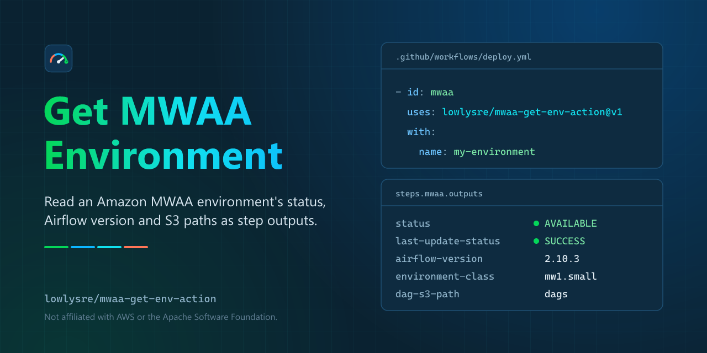

<p align="center">
  
</p>

<p align="center">
  <a href="https://github.com/lowlysre/mwaa-get-env-action/actions/workflows/ci.yml"></a>
  <a href="https://github.com/lowlysre/mwaa-get-env-action/actions/workflows/codeql.yml"></a>
  <a href="https://scorecard.dev/viewer/?uri=github.com/lowlysre/mwaa-get-env-action"></a>
  <a href="LICENSE"></a>
</p>

# Get Amazon MWAA Environment

Read an Amazon MWAA environment from a workflow and act on what you find: gate a deploy on its status, check which `requirements.txt` version it's running, or confirm its status before anything touches it. The action calls `GetEnvironment` (the same call as `aws mwaa get-environment`) with the AWS credentials already in your job, so there are no MWAA CLI or web login tokens to deal with.

Status, Airflow version, environment class, web server URL, and the S3 paths and object versions for requirements, plugins, and the startup script all come back as step outputs. A missing environment fails the step with a clear error, and every run leaves a color-coded log, a job summary, and a warning annotation if the environment is unhealthy.

- 📦 Two runtime dependencies: `@actions/core` and the AWS SDK's MWAA client, bundled into `dist/` with [every third-party license](dist/THIRD_PARTY_LICENSES.txt).
- 🔒 [Immutable releases](https://docs.github.com/en/code-security/concepts/supply-chain-security/immutable-releases): a published release's tag and assets can't be changed, so a pinned version always runs the same code.
- 🛡️ Hardened CI: every job blocks network egress with harden-runner, every action is pinned to a commit SHA, the workflows pass zizmor's pedantic audit, and CodeQL scans the code and workflows.

This action is built and maintained by [lowlysre](https://github.com/lowlysre) 🐍. It's an independent project, not affiliated with or endorsed by AWS.

## Quick start

This example assumes the repository can use GitHub OIDC to assume an AWS role with `airflow:GetEnvironment`. See [permissions](docs/permissions.md) for the policy and trust setup.

```yaml
permissions:
  contents: read
  id-token: write

steps:
  - uses: aws-actions/configure-aws-credentials@v6
    with:
      role-to-assume: ${{ secrets.AWS_ROLE_ARN }}
      aws-region: us-east-1

  - id: mwaa
    uses: lowlysre/mwaa-get-env-action@v1
    with:
      name: my-environment

  - run: echo "Airflow ${{ steps.mwaa.outputs.airflow-version }} is ${{ steps.mwaa.outputs.status }}"
```

The action takes the region and credentials from the AWS environment configured by the preceding step. Pin third-party actions to full commit SHAs in production workflows.

## Outputs

| Output                                                                                            | Description                                           |
|---------------------------------------------------------------------------------------------------|-------------------------------------------------------|
| `status`, `last-update-status`                                                                    | Environment status and the status of its last update. |
| `environment-arn`, `airflow-version`, `environment-class`, `webserver-url`                        | Identity and sizing.                                  |
| `source-bucket-arn`, `dag-s3-path`                                                                | Where DAGs live.                                      |
| `requirements-s3-path`, `plugins-s3-path`, `startup-script-s3-path`                               | S3 paths of the supporting files.                     |
| `requirements-s3-object-version`, `plugins-s3-object-version`, `startup-script-s3-object-version` | S3 version IDs the environment runs.                  |
| `json`                                                                                            | The full `Environment` object, for anything else.     |

Fields the environment doesn't set are empty strings. See the [reference](docs/reference.md) for every field and failure message.

## Action or the AWS CLI

`aws mwaa get-environment` works in a workflow too. The action wraps the same API for the parts that are tedious in shell.

| Need                                             | This action                                                                         | AWS CLI                                        |
|--------------------------------------------------|-------------------------------------------------------------------------------------|------------------------------------------------|
| Outputs usable in later steps                    | ✅ Built in                                                                         | Parse JSON with `jq` yourself                  |
| Clear failure when the environment doesn't exist | ✅ One readable message                                                             | Match stderr text, which varies by CLI version |
| Works without the AWS CLI or `jq` on the runner  | ✅ SDK bundled                                                                      | ❌                                             |
| Log groups, job summary, and failure annotations | ✅                                                                                  | ❌                                             |
| Update or create an environment                  | ❌ See [mwaa-update-env-action](https://github.com/lowlysre/mwaa-update-env-action) | ✅                                             |

## Related actions

[mwaa-update-env-action](https://github.com/lowlysre/mwaa-update-env-action) updates an environment (`aws mwaa update-environment`) and can wait until it is `AVAILABLE` again. The two share input and output names, so a typical pipeline reads the environment with this action, updates it, then reads it again to confirm. See [update an environment and verify it](docs/recipes.md#update-an-environment-and-verify-it) for a complete workflow.

## Documentation

- [Reference](docs/reference.md): inputs, outputs, annotations, and errors
- [Recipes](docs/recipes.md): existence checks, gating deploys, S3 drift, and updating with mwaa-update-env-action
- [Permissions and authentication](docs/permissions.md): IAM policy, OIDC, and troubleshooting
- [Contributing](docs/contributing.md)

## License

Copyright 2026 lowlysre. This action is licensed under the [MIT License](LICENSE); see [NOTICE](NOTICE) for attribution. Third-party code bundled into the action, including the AWS SDK for JavaScript v3 (Apache-2.0), is listed with each license and NOTICE in [dist/THIRD_PARTY_LICENSES.txt](dist/THIRD_PARTY_LICENSES.txt).

AWS, Amazon MWAA, and Amazon Managed Workflows for Apache Airflow are trademarks of Amazon.com, Inc. or its affiliates. This project is independent and not affiliated with or endorsed by AWS.
